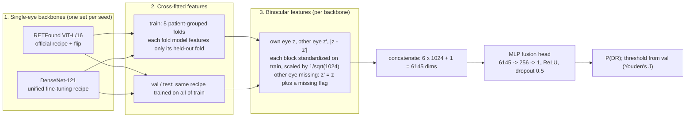

# DBDetect: Diabetic Retinopathy Detection with Binocular Context and Multi-Model Feature Fusion

> CSCE566 final project, Problem 1. This document records the complete work as of 2026-11-26: task, data, evaluation
> protocol, baselines, our method, results and ablations. Every number comes from `results/summary.md`
> (generated by `python -m src.api.summarize`). Open directions are listed in `docs/future_work.md`.

## 0. Summary

On the course version of ODIR-5K (per-eye DR detection), our method fuses the **penultimate features of a fine-tuned
RETFound and a fine-tuned DenseNet-121**, together with **the features of the same patient's other eye**, using an MLP
trained on **patient-grouped cross-fitted features**. It reaches a test AUC of **0.841 ± 0.007**, **+0.048** over the
strongest single baseline (DenseNet-121, 0.793; 95% CI [+0.033, +0.062], p < 0.001), with higher sensitivity,
specificity, and female and male AUC at the same time. Removing any one part (the other eye, either backbone, or the
cross-fitting) lowers test AUC by 0.015–0.028, each significant (Section 6.1).

## 1. Goals

- Assignment: detect diabetic retinopathy (DR) from 2D colour fundus photographs on ODIR-5K. Metrics: overall AUC,
  sensitivity, specificity, and AUC in the female and male groups. Compare with at least two of VGG, ResNet, DenseNet,
  EfficientNet and ViT.
- Questions addressed here:
  1. Under one fair training and evaluation protocol, how well do standard CNNs, ViT and a retinal foundation model
     (RETFound) perform?
  2. How much does information a single-eye model never sees, the patient's other eye, add?
  3. How much of a multi-model fusion gain is complementarity between models, and how much is just having more models?

## 2. Problem setup

### 2.1 Data

| Item | Details |
|---|---|
| Source | Course release of ODIR-5K; one `.npz` file per eye, named `<patient>_<left|right>` |
| Image | `slo_fundus`: 200×200×3 uint8 **colour fundus photograph stored in BGR order** (converted to RGB on load). The key name follows the FairVision file format; the images are not SLO scans |
| Label | `dr_class`: 0 = no DR, 1 = DR (`dr_subtype` maps one-to-one onto it) |
| Sensitive attribute | `male` (consistent across both eyes of a patient). `race`, `hispanic`, `maritalstatus` and `language` differ between the two eyes of the same patient, so they are treated as random fill and not used |
| Split (official folders) | train 4,476 / val 641 / test 1,914 images; DR prevalence 25.0% / 28.5% / 25.6% |
| Patients | 2,350 in train and 1,007 in test, with no patient shared between them; all 335 val patients also appear in test |
| ⚠️ Val and test | **All 641 val images also appear, pixel-identical, in test.** The official split is used as required; every selection uses val only and results are reported on the full test set, which may add a slight optimistic bias (Section 9) |
| Both eyes | About 95% of images have the other eye in the same split; the two eyes' labels agree for 86–88% of patients; if an eye has DR, the other eye has DR in 74–76% of cases, against 8–10% if it does not |
| Label validity | **12.6% of patients with both eyes have different labels for the two eyes**, so the labels are genuinely per eye rather than a patient-level label copied to both eyes |
| Sex in test | 880 female images (223 DR) and 1,034 male images (267 DR) |

### 2.2 Task

**Per-eye binary classification**: given one eye (and, for our method, the other eye of the same patient), output the
probability that this eye has DR.

### 2.3 Evaluation protocol (identical for every method)

| Item | Rule |
|---|---|
| Metrics | Overall AUC (primary), sensitivity, specificity, female AUC, male AUC; accuracy and ES-AUC (FairCLIP's equity-scaled AUC) are also recorded |
| Threshold | Chosen on val with Youden's J, then applied unchanged to test |
| Model selection | Best epoch by val AUC; recipes, augmentation, fusion weights, regularization strength C and the fusion head's epoch are also all chosen by val AUC. **Test is never used for any choice** |
| Seeds | Every configuration runs with seeds 0, 1 and 50; mean ± SD is reported |
| Statistics | Paired bootstrap over patients (2,000 resamples; both eyes of a patient are drawn together) of the test AUC averaged over the 3 seeds; reported as difference, 95% CI and two-sided p |
| Reproducibility | Deterministic CUDA kernels; data order and augmentation of every epoch depend only on (seed, epoch); resuming an interrupted run reproduces an uninterrupted run exactly (verified) |

## 3. Baselines

### 3.1 Models

| Model | Pretrained weights | Parameters |
|---|---|---|
| ResNet-50 | torchvision IMAGENET1K_V2 (timm `resnet50.tv2_in1k`) | 23.5M |
| DenseNet-121 | torchvision IMAGENET1K_V1 (`densenet121.tv_in1k`) | 7.0M |
| ViT-B/16 | ImageNet-21k pre-trained, ImageNet-1k fine-tuned (`vit_base_patch16_224.augreg2_in21k_ft_in1k`) | 86M |

### 3.2 Unified fine-tuning recipe (identical for all baselines; only architecture and weights differ)

| Item | Setting |
|---|---|
| Input | Resize 200→224 (no crop); normalize with each model's pretraining mean/std |
| Loss | Binary cross-entropy on one logit |
| Optimizer | AdamW, lr 1e-4 (batch 64), weight decay 1e-4 (not on 1-D tensors) |
| Schedule | Linear warmup over the first epoch, then per-step cosine decay to 0 |
| Length | 30 epochs; the epoch with the best val AUC is kept |
| Training augmentation | Random resized crop (area 0.85–1, aspect 0.95–1.05), horizontal flip, rotation ±15°, brightness and contrast ±20%; applied on GPU per batch and seeded by (seed, epoch) |
| Precision | bf16 autocast |

**Why not each paper's original recipe.** We first trained every baseline with its paper's recipe: ResNet and DenseNet
with their from-scratch ImageNet SGD settings, and ViT with the fine-tuning settings from its paper.
- With the paper learning rate, the CNNs' training loss stayed above that of predicting the prevalence for many epochs.
  Their test AUC was only 0.70–0.71, with a seed SD of up to 0.066.
- At ×0.1 that learning rate and without augmentation, they memorized the training set within 5 epochs.

From-scratch recipes do not suit fine-tuning, so the main table uses one common fine-tuning recipe. All paper-recipe
results are kept in Section 6.9.

### 3.3 RETFound (retinal foundation model)

RETFound-MAE (Zhou et al., Nature 2023) is a ViT-L/16 with 303M parameters. It was pre-trained with MAE on about 0.9M
fundus photographs from Moorfields and EyePACS, and ODIR is not part of that data. The feature is the mean of the patch
tokens followed by `fc_norm`, as in the official `global_pool=True` path.

**Fine-tuning uses the official recipe released with the paper (v1.0 code):**
- AdamW, base lr 5e-3 (head lr 1.25e-3 at batch 64), layer-wise lr decay 0.65, weight decay 0.05;
- drop path 0.2, label smoothing 0.1;
- 10 warmup epochs, then cosine decay to 1e-6;
- head initialized with truncated normal (std 2e-5);
- augmentation: flip, which beat none and flip_rot on val.

Fine-tuning RETFound with the unified recipe instead is significantly worse (Section 6.8).

## 4. Our method

### 4.1 Idea

1. **Stronger single-eye backbones**: fine-tune RETFound (official recipe) and DenseNet-121 (unified recipe), one a
   domain-pretrained transformer and one an ImageNet-pretrained CNN.
2. **Binocular context**: DR is a systemic disease and the two eyes are strongly correlated. When predicting one eye,
   also feed the features of the other eye and the difference between the two.
3. **Feature-level fusion with cross-fitting**: concatenate the two backbones' penultimate features and train a fusion
   head on them. So that the head never sees training features the backbone has already memorized, every training
   feature comes from **patient-grouped 5-fold cross-fitting** (out-of-fold features). Without it, test AUC falls
   from 0.841 to 0.825 (Section 6.3).

### 4.2 Diagram



### 4.3 Step by step

1. **Folds.** Split the 4,476 training images into 5 patient-grouped, label-stratified folds (`StratifiedGroupKFold`,
   seed 0, 890–901 images per fold). Both eyes of a patient are always in the same fold, so the other eye's feature is
   out-of-fold as well. Saved as `splits/train_5fold.csv`.
2. **Backbones.** For each seed in {0, 1, 50} and each backbone, train 6 models:
   - 5 fold models: each trains on the other 4 folds, picks its epoch on val AUC, and extracts features for the held-out
     fold (out-of-fold).
   - 1 full-train model: trains on all of train and extracts val and test features.

   RETFound uses 30 epochs. These predictions are bit-for-bit identical to the 100-epoch runs, because every best epoch
   falls inside the warmup. DenseNet uses the unified 30-epoch recipe.
3. **Features.** Take the pooled pre-logit representation (1024-d for both RETFound and DenseNet). We verified that
   passing this feature through the model's own head reproduces its predicted probability (difference < 0.001).
4. **Binocular input.** For each image, find the other eye of the same patient in the same split.
   - For each backbone, concatenate three blocks `[z, z', |z - z'|]`.
   - Standardize every block with training statistics and scale it by 1/sqrt(1024), so that blocks contribute equally
     to regularization.
   - For images without the other eye (about 5%), set z' = z and add one "missing" flag.
5. **Fusion head.** Train an MLP on the out-of-fold training features: 6145→256→1, ReLU, dropout 0.5, AdamW lr 1e-3,
   weight decay 1e-3, batch 256, 100 epochs with cosine decay. The epoch is chosen on val AUC; in practice it was
   epoch 8–12. The head's AUC on train is only 0.90–0.94, so cross-fitting worked: the training features were not
   memorized to near-separability (with in-sample features it is 0.99; Section 6.3).
6. **Threshold and evaluation.** Choose the threshold on val with Youden's J and apply it unchanged to test.
7. **Final choice.** Among all fusion variants (probability vs feature level, with or without the other eye, logistic vs
   MLP head), pick the one with the highest val AUC. This is feature level + other eye + MLP, with val 0.844.

**Lightweight variant.** No fusion head; weighted probabilities with every weight chosen on val:
- `p = w·p_RETFound + (1−w)·p_DenseNet` (w = 0.3–0.4),
- then `p' = (1−a)·p + a·p_other_eye` (a = 0.25–0.35).

Its test AUC is 0.836 ± 0.010, not significantly different from the final method, and it is the simplest
implementation.

## 5. Main results (test, mean ± SD over 3 seeds)

| Method | val AUC | **test AUC** | Sensitivity | Specificity | Female AUC | Male AUC |
|---|---|---|---|---|---|---|
| ResNet-50 (unified recipe) | 0.796 | 0.775 ± 0.009 | 0.590 | 0.794 | 0.768 | 0.781 |
| DenseNet-121 (unified recipe) | 0.802 | 0.793 ± 0.020 | 0.669 | 0.776 | 0.790 | 0.796 |
| ViT-B/16 (unified recipe) | 0.772 | 0.767 ± 0.006 | 0.642 | 0.741 | 0.772 | 0.763 |
| RETFound frozen + linear head | 0.770 | 0.768 ± 0.001 | 0.662 | 0.740 | 0.763 | 0.771 |
| RETFound frozen + MLP head | 0.793 | 0.780 ± 0.004 | 0.683 | 0.723 | 0.774 | 0.786 |
| RETFound fine-tuned (official recipe + flip) | 0.805 | 0.798 ± 0.003 | 0.720 | 0.715 | 0.791 | 0.805 |
| Lightweight: probability fusion + other eye | 0.842 | 0.836 ± 0.010 | 0.759 | 0.759 | 0.826 | 0.845 |
| **Ours: feature fusion + other eye + MLP** | **0.844** | **0.841 ± 0.007** | **0.729** | **0.794** | **0.827** | **0.854** |

**Main paired tests** (test AUC difference, patient-level bootstrap with 2,000 resamples):

| Comparison | Difference | 95% CI | p |
|---|---|---|---|
| Ours − DenseNet-121 | **+0.048** | [+0.033, +0.062] | < 0.001 |
| Ours − RETFound fine-tuned | +0.042 | [+0.030, +0.055] | < 0.001 |
| RETFound fine-tuned − DenseNet-121 | +0.005 | [−0.015, +0.025] | 0.61 |
| RETFound fine-tuned − ViT-B/16 | +0.032 | [+0.013, +0.049] | < 0.001 |

**Patient-level DR.** A patient is positive if either eye has DR, and the patient score is the maximum of the two eyes'
probabilities. Test has 1,007 patients with 31.7% prevalence.
- DenseNet: 0.792
- RETFound: 0.804
- Ours: 0.824

The fusion is designed for per-eye prediction, so aggregating to patient level gives less than the per-eye 0.841.

**Sex.** Both groups improve: female 0.790 → 0.827, male 0.796 → 0.854. Males gain more, so the female − male gap
widens from −0.006 to −0.027. A confidence interval for this gap has not been computed yet (see future work).

## 6. Ablations

### 6.1 Removing one part of the final method

Each row changes one thing in the final method and keeps everything else, including the MLP head, the seeds and the
selection on val.

| Configuration | val AUC | test AUC | Final − this | 95% CI | p |
|---|---|---|---|---|---|
| **Final method** (RETFound + DenseNet + other eye, cross-fitted MLP) | 0.844 | **0.841 ± 0.007** | — | | |
| Without the other eye | 0.829 | 0.822 ± 0.006 | +0.019 | [+0.011, +0.027] | < 0.001 |
| Without DenseNet (RETFound + other eye) | 0.816 | 0.813 ± 0.005 | +0.028 | [+0.018, +0.038] | < 0.001 |
| Without RETFound (DenseNet + other eye) | 0.824 | 0.813 ± 0.003 | +0.028 | [+0.017, +0.039] | < 0.001 |
| RETFound replaced by a second DenseNet seed | 0.840 | 0.830 ± 0.008 | +0.010 | [−0.001, +0.021] | 0.064 |
| Without cross-fitting (Section 6.3) | 0.835 | 0.825 ± 0.010 | +0.015 | [+0.006, +0.025] | 0.001 |
| Logistic head instead of the MLP | 0.839 | 0.838 ± 0.003 | +0.002 | [−0.001, +0.006] | 0.19 |
| Probability-level fusion instead of a head | 0.842 | 0.836 ± 0.010 | +0.005 | [−0.002, +0.012] | 0.14 |

**Conclusion.**
- **The three inputs and the cross-fitting are each needed**: removing any one of them costs 0.015–0.028 AUC
  (p ≤ 0.001).
- **The two backbones are equally strong and complementary.** With the same head, RETFound alone and DenseNet alone
  are tied (0.813 each; difference −0.000, p = 0.99), and together they reach 0.841. With a second DenseNet seed
  instead of RETFound, the gap to the final method shrinks to 0.010 (Section 6.4).
- **How the inputs are combined matters little**: the MLP head adds +0.002 over logistic regression and the feature
  level +0.005 over the probability level, neither significant. Without one of the parts, the MLP head is no better
  than logistic regression either (−0.002 to −0.005, p ≥ 0.12).

### 6.2 Adding the components step by step

| Configuration | Components | test AUC |
|---|---|---|
| RETFound fine-tuned (one model, one eye) | — | 0.798 ± 0.003 |
| + DenseNet, probability level | model fusion | 0.819 ± 0.012 |
| + other-eye smoothing, probability level | model fusion + other eye | 0.836 ± 0.010 |
| feature-level fusion instead (logistic regression, C on val) | model fusion + other eye + feature level | 0.838 ± 0.003 |
| MLP fusion head (**final method**) | + non-linear head | **0.841 ± 0.007** |
| RETFound + other eye only (probability / feature) | other eye | 0.812 / 0.815 |
| RETFound + DenseNet without the other eye (probability / feature) | model fusion | 0.819 / 0.824 |

### 6.3 Is cross-fitting necessary?

Without cross-fitting, the fusion head is trained on the features that the full-train backbones extract from their own
training images (`fusion_head.py --insample`). Val and test features, the head and the selection on val are unchanged.

| Fusion head | Train features | Head's train AUC | val AUC | test AUC | Cross-fitted − in-sample | p |
|---|---|---|---|---|---|---|
| MLP, RETFound + DenseNet + other eye (final) | cross-fitted | 0.90–0.94 | 0.844 | 0.841 ± 0.007 | | |
| | in-sample | 0.99 | 0.835 | 0.825 ± 0.010 | **+0.015** [+0.006, +0.025] | 0.001 |
| Logistic, RETFound + DenseNet + other eye | cross-fitted | 0.86–0.94 | 0.839 | 0.838 ± 0.003 | | |
| | in-sample | 0.995–1.000 | 0.838 | 0.831 ± 0.005 | +0.007 [−0.001, +0.015] | 0.10 |
| Logistic, DenseNet + other eye | cross-fitted | 0.80–0.92 | 0.823 | 0.818 ± 0.006 | | |
| | in-sample | 0.96–1.00 | 0.824 | 0.821 ± 0.011 | −0.003 [−0.009, +0.004] | 0.42 |

- **In-sample features are nearly separable** (the head's train AUC is 0.99–1.00). The backbones have memorized their
  training images, and a head fitted on those features learns a mapping that does not hold on unseen images.
- **The MLP head suffers most**, and the drop is already visible on val (0.844 vs 0.835), so cross-fitting is also what
  val alone would choose.
- **Without cross-fitting, feature-level fusion loses its point**: the in-sample MLP is below the probability-level
  variant (0.825 vs 0.836; −0.010 [−0.021, −0.001], p = 0.042).
- Logistic heads are less affected, because their regularization strength C is chosen on val and restrains the
  overfitting.
- **Cost**: 5 extra models per backbone and seed, i.e. 30 trainings (15 of them RETFound). The probability-level variant
  fits its few weights on val and needs no cross-fitting.

### 6.4 Does RETFound contribute? Controls with the same number of models

Replace RETFound with a second DenseNet seed (seed k paired with seed k+1) and keep everything else the same.

| Fusion | RETFound + DenseNet | DenseNet + DenseNet | Difference | p |
|---|---|---|---|---|
| Probability weighting | 0.819 | 0.810 | +0.009 | 0.12 |
| Probability weighting + other eye | 0.836 | 0.824 | +0.012 | 0.031 |
| Feature level, logistic regression | 0.824 | 0.816 | +0.008 | 0.21 |
| Feature level + other eye, logistic regression | 0.838 | 0.829 | +0.009 | 0.12 |
| Feature level + other eye, MLP | 0.841 | 0.830 | +0.010 | 0.064 |

For reference: the 3-seed DenseNet average is 0.818 (0.832 with the other eye), and the 3-seed RETFound average is
0.809.

**Conclusion.** With the same number of models, RETFound is ahead in **all** 5 controls (+0.008 to +0.012), but only one
comparison reaches p < 0.05 on its own. It should be described as a consistent small advantage.

### 6.5 The other eye helps every backbone (probability level, one weight chosen on val)

| Backbone | One eye | + other eye | Gain | p |
|---|---|---|---|---|
| RETFound fine-tuned | 0.798 | 0.812 | +0.014 | < 0.001 |
| DenseNet-121 | 0.793 | 0.810 | +0.017 | < 0.001 |
| ResNet-50 | 0.775 | 0.790 | +0.015 | — |
| ViT-B/16 | 0.767 | 0.779 | +0.012 | — |

### 6.6 Which other-eye blocks?

Per backbone, the final method adds the other eye's features z' and the absolute difference |z − z'|. Keep only one of
the two (MLP head, everything else unchanged):

| Other-eye blocks per backbone | val AUC | test AUC | Final − this | 95% CI | p |
|---|---|---|---|---|---|
| z' and \|z − z'\| (final) | 0.844 | 0.841 ± 0.007 | — | | |
| z' only | 0.840 | 0.840 ± 0.006 | +0.001 | [−0.002, +0.005] | 0.51 |
| \|z − z'\| only | 0.840 | 0.838 ± 0.006 | +0.002 | [−0.002, +0.006] | 0.30 |

Either block alone carries almost all of the binocular information (z' only vs |z − z'| only: +0.001, p = 0.74). Both
together are best on val and are kept, but the exact form does not matter.

### 6.7 Probability level vs feature level (cross-fitted)

| Input | Probability level | Feature level (logistic) | Difference | p |
|---|---|---|---|---|
| DenseNet + other eye | 0.810 | 0.818 | +0.008 | 0.036 |
| RETFound + DenseNet | 0.819 | 0.824 | +0.005 | 0.071 |
| RETFound + DenseNet + other eye | 0.836 | 0.838 | +0.003 | 0.45 |

A feature-level head on a single backbone: RETFound 0.799 (end-to-end 0.798) and DenseNet 0.803 (end-to-end 0.793).

### 6.8 How to adapt RETFound

| Adaptation | Trained parameters | val | test | Best epoch | vs full fine-tuning |
|---|---|---|---|---|---|
| Frozen + linear head (RETFound recipe, cached features) | 1k | 0.770 | 0.768 ± 0.001 | 38–57 | — |
| Frozen + linear head (unified recipe, with augmentation) | 1k | 0.718 | 0.720 ± 0.007 | 27–30 (under-fits) | — |
| Frozen + MLP (256 / 512) | 0.26M / 0.5M | 0.793 / 0.790 | 0.780 / 0.777 | 29–38 | — |
| Last 4 blocks only | 50M | 0.794 | 0.783 ± 0.003 | 7–9 | −0.016, p = 0.002 |
| LP-FT (head initialized from the linear probe, then full fine-tuning) | 303M | 0.789 | 0.788 ± 0.010 | 10–13 | −0.011, p = 0.05 |
| LoRA r=8 on qkv, lr 1e-3 / 3e-4 | 0.79M | 0.796 / 0.793 | 0.797 / 0.800 | 10–20 | not significant |
| Full fine-tuning, unified recipe | 303M | 0.783 | 0.779 ± 0.005 | 4–5 | −0.020, p = 0.001 |
| **Full fine-tuning, official recipe** (30 and 100 epochs identical) | 303M | **0.805** | **0.798 ± 0.003** | 9–10 | reference |

LoRA matches full fine-tuning while training only 0.26% of the parameters, and it peaks later and overfits more
slowly. Full fine-tuning always peaks at the end of warmup, when the learning rate reaches its maximum; val AUC never
recovers that level afterwards.

### 6.9 Training recipes and augmentation (per model)

| Model | Paper recipe ×1: none / flip / flip_rot | Paper recipe ×0.1 | Unified fine-tuning recipe |
|---|---|---|---|
| ResNet-50 | 0.704 / 0.703 / 0.712 (seed SD up to 0.066) | 0.776 ± 0.001 (none) | 0.775 ± 0.009 |
| DenseNet-121 | 0.711 / 0.705 / 0.680 | 0.767 ± 0.005 (none) | **0.793 ± 0.020** |
| ViT-B/16 | 0.767 / 0.770 / **0.785** | 0.771 (flip_rot) | 0.767 ± 0.006 |
| RETFound fine-tuned (own recipe) | 0.785 / **0.798** / 0.792 | stopped early (val ≤ 0.793) | 0.779 ± 0.005 |

All values are test AUC. The paper recipes are:
- ResNet and DenseNet: from-scratch SGD (lr 0.1 at batch 256, scaled to batch 64);
- ViT: its paper's fine-tuning setting (SGD 0.01 at batch 512);
- RETFound: its official recipe.

The unified recipe clearly helps the CNNs (DenseNet +0.026, p = 0.001) and hurts both transformers.

## 7. Key findings

1. **The training recipe can matter more than the architecture.** The same DenseNet scores 0.711 with its paper's
   from-scratch recipe and 0.793 with a common fine-tuning recipe.
2. **Every part of the final method is needed.** Removing the other eye, either backbone or the cross-fitting lowers
   test AUC by 0.015–0.028 (p ≤ 0.001); the head type and the fusion level matter little (+0.002 and +0.005, not
   significant).
3. **The other eye is the most reliable gain**: +0.012 to +0.017 for every backbone, all significant, and −0.019 when it
   is removed from the final method. Its features z' or the difference |z − z'| work equally well.
4. **Multi-model fusion works through complementarity, but much of it comes from the number of models.** With the same
   head, RETFound alone and DenseNet alone are tied (0.813) and reach 0.841 together; with the same number of models,
   RETFound has only a consistent small advantage over a second DenseNet.
5. **Domain pretraining has limited benefit at 200 px.** Frozen RETFound is below a well-tuned ImageNet CNN, and
   fine-tuned RETFound (0.798) is not significantly different from DenseNet (0.793).
6. **Fine-tuned RETFound overfits quickly**, as soon as the peak learning rate is reached; LoRA achieves the same AUC with
   0.26% of the parameters.
7. **Cross-fitting is required for feature-level fusion.** With it, the fusion heads' AUC on train is 0.78–0.96; without
   it, the training features are nearly separable (0.99–1.00) and the final method drops to 0.825, below the
   probability-level variant (0.836). With cross-fitting, the feature level adds +0.003 to +0.008 over the probability
   level.

## 8. Implementation and reproduction

### 8.1 Code layout

| Path | Purpose |
|---|---|
| `src/preprocess/dataset.py` | Load npz (BGR→RGB); data loaders; GPU augmentation (flip, rotation, random resized crop, brightness/contrast); fold hold-out and out-of-fold loader |
| `src/model/baselines.py` | Model builder `build_model`, optimizers (SGD / AdamW with layer-wise decay), learning-rate schedules |
| `src/model/pfm.py` | RETFound loading (with key checks), LoRA, choosing trainable parameters |
| `src/model/train_baseline.py` | End-to-end training: resume, deterministic runs, `best.json`, cross-fitting, `--save-features` |
| `src/model/extract_features.py`, `train_linear_probe.py` | Frozen RETFound features; linear / MLP heads |
| `src/model/run_features.py` | Penultimate features of a trained run |
| `src/model/fusion_head.py` | Feature-level fusion head (logistic / MLP, optional other eye, seed-offset pairing for controls; `--eye-blocks` and `--insample` ablations) |
| `src/api/evaluate.py` | Metrics, Youden threshold, patient-level bootstrap CIs |
| `src/api/fuse.py` | Probability-level fusion (models / other eye / seed ensembles), weights chosen on val |
| `src/api/stats.py`, `summarize.py` | Paired bootstrap; results tables |
| `scripts/dispatch.py` | Multi-GPU job queue: packs jobs by memory and adopts still-running jobs after a restart |
| `config/` | `recipes/finetune.yaml` (unified recipe), `unified/`, `baselines/` (paper recipes), `pfm/` (RETFound variants) |
| `splits/train_5fold.csv` | Cross-fitting folds |
| `environment.yml` | Dependencies (torch 2.6, timm 1.0.24, ...) |

### 8.2 Commands (run from the repository root)

```bash
# baseline (unified recipe), one run per seed
python -m src.model.train_baseline --config config/unified/densenet121.yaml --set train.seed=0
# RETFound fine-tuning (official recipe + flip)
python -m src.model.train_baseline --config config/pfm/retfound_mae_ft_flip30.yaml --set train.seed=0 --save-features train val test
# cross-fitting: fold k
python -m src.model.train_baseline --config config/unified/densenet121.yaml --run-name densenet121_ft_full_cv0_s0 \
    --set train.seed=0 data.cv_file=splits/train_5fold.csv data.cv_fold=0 --save-features oof val test
# final method: feature-level fusion + other eye + MLP
python -m src.model.fusion_head --name rf30+dn_eyes_mlp --backbones retfound_mae_ft30 densenet121_ft_full --eyes --clf mlp
# all tables and paired tests
python -m src.api.summarize
```

The RETFound weights live in the gated Hugging Face repository `YukunZhou/RETFound_mae_natureCFP`; log in and accept the
terms first.

### 8.3 Compute

4 × NVIDIA RTX A6000 (48 GB). The project ran 117 end-to-end trainings (baselines, recipes and augmentation, RETFound
adaptations, and 30 cross-fitting fold models) and 91 fusion runs. Typical run times are 5–15 minutes for
DenseNet / ResNet (30 epochs) and 20–35 minutes for RETFound (30 epochs, with GPUs shared between jobs).

## 9. Limitations

- **Val is a subset of test.** Every choice uses val only, but the 641 val images make up 33.5% of test. Our method makes
  more choices than the baselines (fusion weights, C, the MLP epoch, and one variant out of about 20), so its optimism
  may be larger. Re-testing on the 1,273 test images outside val would check this.
- **The binocular method uses one more image than the baselines** (the patient's other eye). This is clinically
  realistic but must be stated; we also report "+ other eye" for every backbone.
- **Images are only 200 px**, which limits small-lesion detection and may limit the benefit of domain pretraining.
- **Results are not directly comparable with published work.** The standard ODIR evaluation is patient-level 8-class
  multi-label, which the course data cannot support.
- Semantic information, cross-eye attention, loss design and fairness constraints are not explored yet; see
  `docs/future_work.md`.
